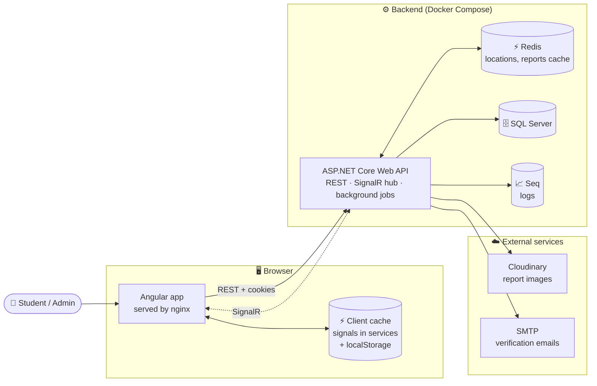

<div align="center">

# 🗺️ AABU Reports

**Report campus problems on a map. Track them until they're fixed.**


[Features](#-features) · [Architecture](#-architecture) · [Caching](#-caching) · [Quick start](#-quick-start) · [Configuration](#-configuration) · [API](#-api-overview) · [Tests](#-running-the-tests)

</div>

<!--
  Add a screenshot of the campus map page here, for example:
  <p align="center"></p>
-->

---

## 📖 About

AABU Reports is a campus maintenance reporting platform. Students pin a problem on an interactive map, attach photos, and follow the fix through to completion. Admins triage reports, update their status, and talk to the reporter, all in real time.

The backend is an ASP.NET Core (.NET 10) Web API and the frontend is an Angular single-page app with an Arabic UI.

## ✨ Features

<table>
<tr>
<td width="50%" valign="top">

### 🎓 For students

- 📍 **Interactive campus map** (Google Maps): pick a building or drop a custom pin
- 📝 **Rich reports**: category, severity, description (up to 500 characters)
- 📷 **Photo uploads**: up to 5 images, 5 MB each, stored on Cloudinary
- 💬 **Live chat** on every report, with typing indicators
- 🔔 **Real-time notifications** with an unread counter
- ⭐ **Rate the fix** (1–5) once a report is fixed
- 📜 **Report history** with search, filters and stats
- 🔐 **Secure sign-up**: 10-digit student ID, email verification code, JWT access and refresh tokens in cookies

</td>
<td width="50%" valign="top">

### 🛠️ For admins

- 🏢 **Manage campus buildings**: create, edit, delete
- 📋 **See every report**, not just your own
- 🔄 **Update report states** and keep reporters informed
- 🗑️ **Delete** reports and locations
- 🌱 **Seeded admin account** created from environment variables on startup
- 🧹 **Automatic cleanup**: daily jobs remove expired refresh tokens and orphaned images

</td>
</tr>
</table>

### 🏷️ Report model

| | Values |
|---|---|
| **Category** | `Electrical` · `Plumbing` · `Roads` · `Furniture` · `Cleaning` · `Other` |
| **Severity** | `Small` · `Medium` · `Large` |
| **State** | `Normal` · `Fixed` · `InProgress` · `Pending` · `NeedsFollowUp` |
| **Location type** | `Pin` · `Building` |

> [!TIP]
> A location always shows the highest-priority state among its reports, so the map highlights what needs attention first.

## 🧱 Architecture




### ⚡ Caching

Data is cached at three levels, so most navigation doesn't hit the database at all.

| Layer | What is cached | Behavior |
|---|---|---|
| **Browser (Angular services)** | Campus locations, each location's loaded reports, the reports history pages (keyed by filters and page number), report stats, and chat messages per report | Held in memory as signals. Locations load once and stay up to date as you create, edit or delete. History pages are dropped when a report is deleted or the history page is reopened. |
| **Browser (localStorage)** | The signed-in user and the theme choice | Survives page reloads |
| **nginx** | Hashed JS, CSS, fonts and images | Cached for a year; `index.html` is never cached, so new deployments are picked up |
| **Redis** | Locations and reports | Backend cache with sliding and absolute expiration, cleared by key prefix when data changes |


The backend follows a layered layout:

```
aabu-reports/
├── src/
│   ├── AabuReports.Core/            # Entities, DTOs, enums, abstractions, validation
│   ├── AabuReports.Infrastructure/  # EF Core, repositories, services, Redis caching,
│   │                                # background jobs, migrations
│   └── AabuReports.Webapi/          # Controllers, SignalR hub, auth, middleware, Dockerfile
├── tests/
│   ├── AabuReports.Services.UnitTests/
│   └── AabuReports.Repository.UnitTests/
├── front-end/                       # Angular app (nginx Dockerfile included)
├── compose.yaml
├── .env.example
└── aabu-reports.sln
```

### 🧰 Tech stack

| Layer | Technology |
|---|---|
| **Frontend** | Angular 22, Tailwind CSS 4, RxJS, `@microsoft/signalr`, Vitest |
| **Backend** | .NET 10, ASP.NET Core Web API, SignalR, ASP.NET Identity, EF Core 10 |
| **Data** | SQL Server, Redis (locations and reports cache) |
| **Services** | Cloudinary (images), MailKit (SMTP email) |
| **Observability** | Serilog → console, rolling file, Seq |
| **API docs** | OpenAPI + Scalar (Development only) |
| **Testing** | xUnit, Moq, FluentAssertions, AutoFixture, SQLite |
| **Deployment** | Docker, Docker Compose, nginx |

## 🚀 Quick start

### Prerequisites

- [Docker](https://www.docker.com/) and Docker Compose
- A [Cloudinary](https://cloudinary.com/) account (image uploads)
- An SMTP account (verification emails, for example Gmail with an app password)

For local development without Docker you also need the [.NET 10 SDK](https://dotnet.microsoft.com/), [Node.js 22+](https://nodejs.org/), SQL Server and Redis.

### Run with Docker

**1. Clone the repo**

```bash
git clone https://github.com/<your-username>/aabu-reports.git
cd aabu-reports
```

**2. Create your environment file**

```bash
cp .env.example .env
```

Edit `.env` (see [Configuration](#-configuration)). Generate a strong JWT key with:

```bash
openssl rand -base64 64
```

**3. Start everything**

```bash
docker compose up --build
```

**4. Apply the database migrations** (once)

```bash
dotnet tool install --global dotnet-ef   # if you don't have it yet

dotnet ef database update \
  --project src/AabuReports.Infrastructure \
  --startup-project src/AabuReports.Webapi
```

> [!IMPORTANT]
> The API does **not** migrate the database on startup, so step 4 is required on a fresh database. Set `ConnectionStrings:Default` to the SQL Server container (`localhost:1433`, user `sa`, the `SQL_PASSWORD` from your `.env`) when you run it.

**5. Open the app**

| Service | URL |
|---|---|
| 🌐 Web app | http://localhost:4000 |
| ⚙️ API | http://localhost:8080 |
| 📈 Seq (logs) | http://localhost:5341 |
| 🗄️ SQL Server | `localhost:1433` |
| ⚡ Redis | `localhost:6379` |

<details>
<summary><b>💻 Run locally without Docker</b></summary>

<br>

**Backend**

```bash
cd src/AabuReports.Webapi
dotnet user-secrets set "JWT:Key" "<a-long-random-key-at-least-32-chars>"
dotnet user-secrets set "ConnectionStrings:Default" "<your SQL Server connection string>"
dotnet user-secrets set "ConnectionStrings:Redis" "localhost:6379"
# plus SeedAdmin:*, CloudinarySettings:* and Email:* (see Configuration)

dotnet run
```

The API listens on `http://localhost:5299` (or `https://localhost:7284`). In Development, interactive API docs are served by Scalar.

**Frontend**

```bash
cd front-end
npm install
npm start        # http://localhost:4200
```

> [!NOTE]
> The frontend calls the API at `http://localhost:8080` (`front-end/src/app/core/constants/URLs.ts`). If your API runs on a different port, or you deploy elsewhere, update that file.

</details>

## ⚙️ Configuration

Docker Compose reads these from `.env`. For local runs, set the matching .NET configuration keys through user-secrets or environment variables.

<details open>
<summary><b>Environment variables</b></summary>

<br>

| `.env` variable | Maps to | Description |
|---|---|---|
| `ASPNETCORE_ENVIRONMENT` | `ASPNETCORE_ENVIRONMENT` | `Development` or `Production` |
| `SQL_PASSWORD` | `ConnectionStrings:Default` | SQL Server `sa` password |
| `SEQ_PASSWORD` | Seq admin password | Password for the Seq log UI |
| `JWT_KEY` | `JWT:Key` | Token signing key (at least 32 characters; 64+ recommended) |
| `ADMIN_STUDENT_ID` | `SeedAdmin:StudentId` | Student ID of the seeded admin |
| `ADMIN_PASSWORD` | `SeedAdmin:Password` | Seeded admin password (**required**) |
| `ADMIN_EMAIL` | `SeedAdmin:Email` | Seeded admin email |
| `ADMIN_FULL_NAME` | `SeedAdmin:FullName` | Seeded admin display name |
| `CloudName`, `ApiKey`, `ApiSecret` | `CloudinarySettings:*` | Cloudinary credentials |
| `SMTP_HOST`, `SMTP_PORT`, `SMTP_ENABLE_SSL` | `Email:*` | SMTP server settings |
| `SMTP_USERNAME`, `SMTP_FROM`, `SMTP_PASSWORD` | `Email:*` | SMTP credentials and sender address |

</details>

<details>
<summary><b>appsettings.json options</b></summary>

<br>

Found in `src/AabuReports.Webapi/appsettings.json`:

| Key | Purpose |
|---|---|
| `Cors:AllowedOrigins` | Allowed frontend origins (default `http://localhost:4200` and `http://localhost:4000`). Credentials are enabled, so no wildcards. |
| `JWT` | Access token lifetime (24 h), refresh token lifetime (7 days), issuer and audience |
| `Email:VerificationCodeLifetimeMinutes` | How long an email code stays valid (5 minutes) |
| `Redis` | Key prefix and cache expiration |
| `Serilog` | Log sinks and levels |

</details>

> [!WARNING]
> Remove the admin seed variables after your first deploy, and keep `.env` out of version control.

## 🔌 API overview

All routes are under `/api`. Everything except registration and authentication requires a signed-in user. 🔒 marks admin-only endpoints.

<details open>
<summary><b>Endpoints</b></summary>

<br>

| Area | Method | Route |
|---|---|---|
| **Account** | `POST` | `/account/register` |
| | `GET` | `/account/me` |
| | `POST` | `/account/is-admin` |
| **Auth** | `POST` | `/auth/login` · `/auth/verify-email` · `/auth/resend-code` · `/auth/refresh` · `/auth/logout` |
| **Locations** | `GET` | `/location` |
| | `POST` `PUT` | `/location` 🔒 |
| | `DELETE` | `/location/{id}` 🔒 |
| **Reports** | `GET` | `/report/table` · `/report/table/stats` · `/report/location` · `/report/stats` · `/report/{id}` |
| | `POST` | `/report` · `/report/coordinates` |
| | `PUT` | `/report/state` 🔒 · `/report/rate` |
| | `DELETE` | `/report/{id}` 🔒 |
| **Messages** | `GET` | `/message` |
| **Notifications** | `GET` | `/notification` · `/notification/unread-count` |
| | `PUT` | `/notification/read-all` |

</details>

- **Rate limiting:** registration, login, email verification and code resend are limited to 10 requests per minute per IP.
- **Real time:** a single SignalR hub at `/hubs/app` pushes notifications and report chat (`ReceiveNotification`, `ReceiveMessage`, `NotifyTyping`, `NotifyStoppedTyping`).
- **Background jobs:** two daily jobs remove expired refresh tokens and orphaned images (Cloudinary and database).

## 🧪 Running the tests

```bash
dotnet test                  # backend (xUnit)
cd front-end && npm test     # frontend (Vitest)
```

The repository tests run against an in-memory SQLite database, so no external services are needed.

## 📦 Deployment notes

- The API image is built from `src/AabuReports.Webapi/Dockerfile`; the frontend from `front-end/Dockerfile` (multi-stage build served by nginx with SPA fallback and long-lived caching for hashed assets).
- Before going to production: set strong secrets, add your frontend origin to `Cors:AllowedOrigins`, point `URLs.ts` at your API, and use your own Google Maps API key and map ID (`front-end/src/app/core/constants/google-maps.ts`).

## 🤝 Contributing

Issues and pull requests are welcome. Please run the test suites before submitting a PR.

## 📄 License

This project is licensed under the [MIT License](LICENSE). You're free to use, modify and distribute it.